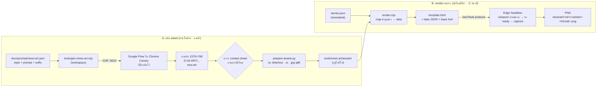

# Artwork ข่าว iHC-Press: การทำงานและแผนพัฒนา

> อัปเดต 2026-10-17 · โค้ด `iHC-Press\tools\news-art\` (commit `37148dc`, branch `ihc-rename`) · prompt [`prompt/news-art.json`](prompt/news-art.json)
> เอกสารนี้ใช้ทั้งเป็นคู่มือ (§3) และฐานสำหรับวางแผนพัฒนาต่อ (§6–§9)

## 0. สถานะตอนนี้

| เรื่อง | สถานะ |
|---|---|
| ทำภาพข่าวจากข่าวในโต๊ะข่าว (`--story <id>`) 3 แบบ × 3 ขนาด | ✅ ใช้ได้ผ่านคำสั่ง ทดสอบกับข่าวจริง 2 ข่าว (19 ภาพตัวอย่าง) |
| ภาพประกอบประจำสายข่าว 9 สาย + เฟรม 3 ขนาด + พื้นผิว 2 แบบ | ✅ อยู่ในรีโป (`tools\news-art\assets\`, 1.6 MB) |
| ข้อความไทยถูกต้อง, ย่อหัวข่าวให้พอดี, คำทับศัพท์ไม่ถูกตัด, กันอักขระพิเศษ | ✅ |
| ปุ่มในแอป / แสดงภาพในหน้าโต๊ะข่าว | ✅ (2026-10-17) ภาพย่อบนการ์ด · หน้าอ่านข่าวมีภาพ 3 ขนาด เลือกแบบ สร้างใหม่ ดูภาพเต็ม เปิดโฟลเดอร์ · ทดสอบ UI ผ่าน 12/12 |
| สร้างอัตโนมัติ | ✅ ข่าวที่ถึง ready/published ได้ภาพภายใน ~30 วินาที และสร้างใหม่เมื่อพาดหัวหรือบรีฟเปลี่ยน (`render.mjs --pending`, `meta.json`) |
| ฝ่ายภาพ (บอท) เลือกแบบภาพเอง | ✅ บรีฟแบบมีโครงสร้าง (`แบบภาพ:` `ประเด็น:` `ภาพจากข่าว:`) · 🧪 ยังไม่ได้เห็นบอทเขียนจริงเพราะ LLM ไม่ตอบ |
| ภาพประกอบเฉพาะข่าว (สร้างใหม่ต่อข่าว) | ⬜ ต้องสั่ง Flow เอง (§7 ระยะที่ 3) |
| ไฟล์ปลายทางถูก publish หรือโพสต์ขึ้นโซเชียลอัตโนมัติ | ⬜ ไม่อยู่ในขอบเขตตอนนี้ |

## 1. หลักการ: แยกภาพกับตัวอักษร

| ชั้น | ใครทำ | ทำไม |
|---|---|---|
| **ภาพ** (ภาพประกอบ, เฟรมขอบ, พื้นผิว) | Google Flow · Nano Banana 2.1 (ไม่เสียเครดิต) | ภาพ 3D สวยและคุมโทนแบรนด์ได้ แต่ **สะกดอักษรไทยผิด** ทุก prompt จึงลงท้ายด้วย "No text, no letters…" |
| **ตัวอักษร** (หัวข่าว, ป้ายสายข่าว, วันที่, ที่มา, wordmark) | เทมเพลต HTML + ฟอนต์ Noto Sans Thai → Edge แบบ headless ถ่ายเป็น PNG | เป็นฟอนต์จริง สระวรรณยุกต์ถูก 100% แก้คำได้ทันทีโดยไม่ต้องสร้างภาพใหม่ |

ผลที่ได้: **ภาพสร้างครั้งเดียวแล้วใช้ซ้ำได้ทุกข่าว** ส่วนการ render ต่อข่าวไม่ต้องพึ่ง Flow, Google login หรืออินเทอร์เน็ต ใช้เวลาราว 2 วินาทีต่อ 3 ขนาด จึงเหมาะจะทำเป็นอัตโนมัติ

## 2. การทำงาน (pipeline)



### 2.1 ขั้น render ทีละขั้น (`render.mjs`)

1. อ่าน argument → ถ้ามี `--story` ก็อ่าน `<news>\stories.json` (พาธจาก `tools\paths.mjs` = `paths.json` เดียวกับแอป)
2. สร้าง `data`: หัวข่าว, ป้ายสายข่าว, คำโปรย, ที่มา, วันที่ไทย, ภาพหลัก (ตามตาราง §2.2)
3. เปิด Edge headless **ครั้งเดียว** ด้วย `--remote-debugging-port=0` แล้วอ่านพอร์ตจากไฟล์ `DevToolsActivePort`
4. ทุก format: เขียน HTML ชั่วคราว (template + `<base href>` ชี้โฟลเดอร์ tools\news-art + data JSON ที่แปลง `<` เป็น unicode escape กัน `</script>`) → `Emulation.setDeviceMetricsOverride` ตามขนาด → `Page.navigate` → รอ `document.title === "ready"` → รอ 2 frame → `Page.captureScreenshot`
5. ปิดเบราว์เซอร์ ลบโฟลเดอร์ชั่วคราว (ตั้ง `KEEP_TMP=1` ถ้าจะเก็บไว้ debug)

### 2.2 ข้อมูลข่าว → องค์ประกอบในภาพ

| องค์ประกอบ | มาจาก (ตามลำดับ) | หมายเหตุ |
|---|---|---|
| หัวข่าว | `--headline` → `story.headline` → `story.title` | ต้องมี ไม่งั้นหยุดทำงาน |
| ป้ายสายข่าว | `--beat` → `story.beat` → `other` | ชื่อไทยจากตาราง `BEATS` ใน render.mjs (`other` แสดงเป็น "ฮาร์ดแวร์-คอมพิวเตอร์") |
| คำโปรย (dek) | `--dek` → ย่อหน้าแรกของ `story.body` ตัดที่ ~150 ตัวอักษร | แสดงสูงสุด 2 บรรทัด |
| bullet (แบบ card) | `--points "a\|b\|c"` | สูงสุด 3 ข้อ ยังไม่ดึงจากข่าว |
| ที่มา | `--source` → hostname ของ `story.sources[0]` | ตัด `www.` |
| วันที่ | `--date` → `story.updatedAt` → วันนี้ | `th-TH` เช่น "17 ต.ค. 2569" |
| ภาพหลัก | `--art <ไฟล์>` → ภาพประจำสายข่าว (`ART` map) | ช่อง `image` (บรีฟภาพ) **ยังไม่ถูกอ่าน** |

### 2.3 ภายในเทมเพลต (`template.html`)

- **ชั้นภาพ (ล่าง→บน):** พื้นผิว/ภาพหลัก → เงาไล่ (shade/seam) → เฟรมวงจร (`mix-blend-mode: screen` ส่วนดำของเฟรมจึงหายไป เหลือแต่ขอบเรืองแสง, opacity .6) → masthead (wordmark บนแผ่นดำ + วันที่) → เนื้อข่าว → footer
- **ระยะขอบ:** `--pad` = 8.5% ของความสูง, `--padx` = 7.5% ของความกว้าง เพื่อให้ข้อความอยู่ในกรอบเฟรม
- **ย่อหัวข่าวให้พอดี:** เริ่มที่ 2.6U (16:9) หรือ 2.2U (1:1, 4:5) แล้วลดทีละ 2px จนจำนวนบรรทัด ≤ งบบรรทัด (16:9 photo = 3 บรรทัด, แบบอื่น = 4) ต่ำสุด 1.15U ถ้ายังไม่พอจะตัดด้วย "…" (`-webkit-line-clamp`) · U = 40/34/36 px ตามขนาด
- **นับบรรทัดด้วยความสูงจริง ÷ line-height** (ไม่ใช่ `scrollHeight`) เพราะสระบนล่างของไทยยื่นพ้นกรอบบรรทัด
- **รอฟอนต์ก่อนวัด:** `document.fonts.load()` ทุกน้ำหนักที่ใช้ แล้วจึงตั้ง `document.title = "ready"` ซึ่งเป็นสัญญาณให้ render.mjs ถ่าย
- **คำห้ามตัด:** รายการ `KEEP` ครอบคำด้วย `<span class="nb">` (white-space: nowrap) และผู้ใช้ครอบเองได้ด้วย `{...}`
- **ความปลอดภัย:** ทุกข้อความผ่าน `esc()` ก่อนใส่ HTML · พาธภาพใส่ใน `url('...')` แบบ single quote

## 3. วิธีใช้

```powershell
cd D:\SalmonRK\BotPress\iHC-Press
node tools\news-art\render.mjs --story 20261014-01                                   # 16:9, 1:1, 4:5 แบบ photo
node tools\news-art\render.mjs --story 20261014-01 --variant breaking --formats 16x9,4x5
node tools\news-art\render.mjs --story 20261014-01 --art <ภาพของข่าว เช่น ภาพหน้าจอจาก YouTube digest>
node tools\news-art\render.mjs --id cpu-tips --variant card --beat other --headline "สรุป 3 เรื่องต้องรู้ ก่อนอัปเกรดซีพียู" --points "ข้อ 1|ข้อ 2|ข้อ 3" --source "ทีมข่าว iHC-Press"
```

| ตัวเลือก | ความหมาย |
|---|---|
| `--variant` | `photo` (ค่าเริ่มต้น) · `breaking` · `card` |
| `--formats` | คั่นด้วยจุลภาค: `16x9` (1600×900 ปกข่าว/ลิงก์) · `1x1` (1080×1080 โพสต์) · `4x5` (1080×1350 โพสต์แนวตั้ง) |
| `--out` | โฟลเดอร์ปลายทาง (ค่าเริ่มต้น `D:\AI-ART\BotPress\data\news\art\<id>\`) |
| `--headline` `--dek` `--source` `--date` `--beat` `--points` `--lines` `--art` `--id` | กำหนดค่าเองแทนข้อมูลจากข่าว |
| env `BROWSER` | พาธ Edge/Chrome ถ้าไม่ได้อยู่ที่ปกติ |

| variant | หน้าตา |
|---|---|
| `photo` | 16:9 ภาพเต็มกรอบ ไล่เงาดำด้านล่าง หัวข่าวมีแถบแดงซ้าย · 1:1 และ 4:5 ภาพอยู่บน ข้อความบนแผงลายวงจร |
| `breaking` | พื้นเส้นแสงแดงวิ่ง ป้ายขาว "ข่าวด่วน" ภาพอยู่ในการ์ดขอบแดงเรืองแสง (16:9 ภาพอยู่ขวา ข้อความซ้าย) |
| `card` | ไม่มีภาพข่าว พื้นลายวงจร หัวเรื่องใหญ่ + bullet ≤ 3 ข้อ จัดกึ่งกลางแนวตั้ง |

## 4. ไฟล์และหน้าที่ (code map)

| ไฟล์ | หน้าที่ | จุดที่แก้บ่อย |
|---|---|---|
| `iHC-Press\tools\news-art\render.mjs` | CLI: อ่านข่าว → data → ขับ Edge ผ่าน DevTools → PNG | `BEATS`, `ART` (สาย→ภาพ), `FORMATS`, `FRAME` |
| `iHC-Press\tools\news-art\template.html` | เลย์เอาต์ทุก variant, ย่อหัวข่าว, คำห้ามตัด | CSS token (`--red` ฯลฯ), `KEEP`, บล็อก `if (d.variant === ...)` |
| `iHC-Press\tools\news-art\assets\*.jpg` | ภาพพร้อมใช้ 14 ไฟล์ | ได้จาก prepare-assets.py เท่านั้น |
| `iHC-Press\tools\news-art\fonts\` | Noto Sans Thai (variable, OFL) — มี Latin ในตัว | |
| `iHC-Press\tools\news-art\prepare-assets.py` | ภาพดิบ → assets (ตัด letterbox ที่มีทั้งบนและล่าง, ย่อ ≤1920) | |
| `D:\SalmonRK\BotPress\tools\gen-news-art.mjs` | สั่ง Flow ทีละภาพ (warm-up, ลองใหม่เมื่อได้ภาพเก่า) อยู่นอกรีโปเหมือน gen-avatars | |
| `docs\prompt\news-art.json` | style + prompt ของทั้ง 14 ภาพ | เพิ่ม item เมื่อเพิ่มสาย/เฟรม |
| `iHC-Press\tools\paths.mjs` | หาโฟลเดอร์ news จาก `paths.json` | |

## 5. วิธีต่อยอด (สูตรสำหรับนักพัฒนา)

| อยากได้ | ทำที่ |
|---|---|
| **เพิ่มสายข่าว/ภาพประจำสาย** | เพิ่ม item `beat-<x>` ใน news-art.json → `gen-news-art.mjs <dir> beat-<x>` → ตรวจภาพ → `prepare-assets.py` → เพิ่มใน `BEATS` และ `ART` ของ render.mjs (และ `BEATS` ใน newsdesk/server.mjs ถ้าเป็นสายใหม่จริง) |
| **เพิ่มขนาด** (เช่น 9:16 story) | เพิ่มใน `FORMATS` + `FRAME` ของ render.mjs, เพิ่ม `[W,H,U]` ใน `F` ของ template, สร้างเฟรม 9:16 จาก Flow · ภาพประกอบ 16:9 จะถูก crop ตรงกลาง ควรมีภาพแนวตั้งแยก |
| **เพิ่ม variant** (เช่น quote, ตัวเลข) | เพิ่มบล็อก `else if (d.variant === "...")` ใน template + CSS `body.<variant>` · ข้อมูลใหม่ส่งผ่าน argument แล้วใส่ใน `data` |
| **เปลี่ยนแบรนด์/สี** | token ใน `:root` ของ template · wordmark อยู่ในตัวแปร `logo` |
| **คำถูกตัดผิด** | เพิ่มคำใน `KEEP` · ถ้าคำยาวขึ้นต้นเหมือนคำสั้น (เช่น "อัปเดต" กับ "อัปเดตใหม่") ให้วางคำยาวไว้ก่อน เพราะ regex เลือกคำแรกในรายการที่ตรงตำแหน่งเดียวกัน |
| **debug เลย์เอาต์** | `KEEP_TMP=1` แล้วเปิด HTML ชั่วคราวใน `%TEMP%\ihc-art-*` ด้วยเบราว์เซอร์ปกติ |

## 6. ข้อจำกัดและเงื่อนไขที่ต้องรู้ก่อนวางแผน

| ข้อจำกัด | ผลกระทบต่อการพัฒนา |
|---|---|
| **โต๊ะข่าว (newsdesk) รันใน container บน WSL ไม่มีเบราว์เซอร์** | บอทเรียก render เองไม่ได้ ต้องให้แอปบน Windows ทำแทน แบบเดียวกับที่ทำ YouTube digest อยู่แล้ว (คิวคำขอ, §7 ระยะที่ 2) |
| **Flow ต้องใช้ Chrome Canary ที่ล็อกอิน Google + CDP :9222** และมี reCAPTCHA เป็นครั้งคราว | การสร้างภาพใหม่ต่อข่าวยังเป็นงานที่คนต้องคุม ไม่เหมาะกับรอบอัตโนมัติของบอท |
| **Flow ส่งภาพช้า/ภาพเก่าได้** (เคยเลื่อนไฟล์ทั้งชุด) | ทุกการสร้างต้องมีขั้นตรวจ (contact sheet หรือเทียบ hash) ก่อนนำไปใช้ |
| Flow ให้ภาพ 1376×768 | 16:9 ที่ 1600×900 ถูกขยายเล็กน้อย ถ้าต้องการงานพิมพ์หรือ 4K ต้องหาแหล่งภาพความละเอียดสูงกว่า |
| ต้องมี Edge/Chrome และ Node.js บนเครื่องที่ render | มีในเครื่องนี้แล้ว (Node 24, Edge) · ถ้าย้ายไปเครื่องอื่นต้องติดตั้ง |
| การตัดคำไทยใช้พจนานุกรมของ Chrome | คำใหม่ ๆ อาจถูกตัด ต้องเติม `KEEP` หรือใช้ `{...}` |
| ช่อง `image` (บรีฟภาพ) เป็นข้อความอิสระ | ยังให้เครื่องอ่านไม่ได้ ต้องกำหนดรูปแบบก่อน (§7 ระยะที่ 2) |
| ภาพประจำสายใช้ซ้ำทุกข่าว | ข่าวสายเดียวกันหน้าตาเหมือนกัน ถ้าโพสต์ถี่ควรมีหลายภาพต่อสาย (§7 ระยะที่ 3) |

## 7. แผนพัฒนา (roadmap)

> ประมาณการเป็น "วันทำงานของนักพัฒนา 1 คน" ไม่รวมเวลารอผู้ใช้ตรวจภาพ เรียงตามลำดับที่แนะนำ แต่ละระยะใช้งานได้ด้วยตัวเอง

> **ความคืบหน้า 2026-10-17:** ระยะที่ 1 เสร็จ และระยะที่ 2 เสร็จแบบไม่ต้องมีเครื่องมือใหม่: แทนที่จะให้บอทเรียก `request_artwork` แอปอ่านบรีฟภาพแล้วสร้างให้เองเมื่อข่าวถึง ready (ล้มเหลวน้อยกว่า เพราะไม่ต้องพึ่งให้บอทจำขั้นตอน) · ชุดทดสอบ `tests\news-art.mjs` 6/6

### ระยะที่ 1 — ปุ่ม "สร้างภาพข่าว" ในแอป (~1–1.5 วัน) ✅

- **เป้าหมาย:** คนในห้องข่าวกดปุ่มเดียวแล้วเห็นภาพทั้ง 3 ขนาดในหน้าอ่านข่าว ไม่ต้องเปิด terminal
- **งาน:**
  1. `BotPress.csproj`: publish `tools\news-art\**` ไปกับแอป (เหมือน `tools\yt-digest.mjs`)
  2. C#: เพิ่ม `Newsdesk.RenderArt(id, variant)` เรียก `node render.mjs --story <id> --variant <v>` ด้วย `Exec` แบบเดียวกับ `Settings.Digest` และคืนรายการไฟล์
  3. `MainWindow.xaml.cs`: เพิ่ม case `art.render`, `art.list` (คืนภาพเป็น data URI แบบภาพหน้าจอ YouTube ใน `Settings.YtList`), `art.folder`
  4. `ui/newsdesk.js`: ในหน้าอ่านข่าว ต่อจากส่วน "บรีฟภาพ" เพิ่มส่วน "ภาพข่าว": ปุ่มเลือก variant, ปุ่มสร้าง (มี loading), ภาพย่อ 3 ขนาด, ปุ่มเปิดโฟลเดอร์
- **เสร็จเมื่อ:** กดปุ่มกับข่าวสถานะ ready แล้วเห็นภาพภายใน 5 วินาที · ข่าวที่ไม่มีหัวข่าวแสดงข้อความผิดพลาดที่อ่านเข้าใจ · e2e test เพิ่ม 1 ขั้น
- **ความเสี่ยง:** ต่ำ ใช้รูปแบบที่มีอยู่แล้วทั้งหมด

### ระยะที่ 2 — ฝ่ายภาพ (บอท) สั่งทำภาพเอง (~2–3 วัน)

- **เป้าหมาย:** ข่าวที่ถึงสถานะ ready มีภาพพร้อมโพสต์ติดมาด้วย โดยไม่ต้องมีคนสั่ง
- **งาน:**
  1. **บรีฟภาพแบบมีโครงสร้าง:** กำหนดบรรทัดที่เครื่องอ่านได้ใน `image` เช่น `variant: photo|breaking|card`, `art: <ไฟล์ในโฟลเดอร์ข่าว>` (เช่น ภาพหน้าจอจาก youtube_digest), `points: a | b | c` โดยยังเขียนคำบรรยายและ alt text ได้เหมือนเดิม
  2. **เครื่องมือใหม่ใน newsdesk/server.mjs:** `request_artwork` เขียนไฟล์คำขอลง `<news>\art\requests\` (แบบเดียวกับ `youtube_digest`) แล้วคืนสถานะ queued/pending/done พร้อมชื่อไฟล์ · เพิ่ม test ในชุดทดสอบของ server
  3. **แอปประมวลผลคิว:** loop เดิมทุก 15 วินาทีที่เรียก `ProcessYtQueue` ให้เรียก `ProcessArtQueue` ด้วย
  4. **render.mjs อ่านบรีฟ:** แยกบรรทัด `variant/art/points` จาก `story.image`
  5. **ปรับ prompt ฝ่ายภาพใน `seed-bots.mjs`:** จาก "ไม่สร้างภาพ" เป็น "เขียนบรีฟแบบมีโครงสร้าง แล้วเรียก request_artwork"
  6. (เลือกได้) ให้ `publish_story` แนบรายชื่อไฟล์ภาพใน markdown ที่ publish
- **เสร็จเมื่อ:** รอบข่าว 1 รอบจบด้วยข่าว ready ที่มีไฟล์ภาพใน `art\<id>\` โดยไม่มีคนสั่ง
- **ความเสี่ยง:** กลาง บอทอาจเขียนบรีฟผิดรูปแบบ (ต้องมี fallback เป็น photo + ภาพประจำสาย) · ต้องรอ LLM (LocalAI-07) กลับมาปกติก่อนจึงทดสอบรอบเต็มได้

### ระยะที่ 3 — ภาพประกอบหลากหลายขึ้น (~1–3 วัน ขึ้นกับทางเลือก)

- **3a. หลายภาพต่อสาย (แนะนำทำก่อน, ~1 วัน):** สร้างภาพประจำสายสายละ 3–5 ภาพ (`beat-ai-1..5`) แล้วสุ่มหรือหมุนตาม id ข่าว ทำให้ข่าวสายเดียวกันไม่ซ้ำหน้ากัน · ใช้ Flow แบบเดิม ไม่เสียเครดิต
- **3b. ภาพเฉพาะข่าวจาก Flow แบบคนกดอนุมัติ (~2 วัน):** ปุ่ม "สร้างภาพประกอบใหม่" ส่งไอเดียภาพจากบรีฟไปที่ Flow (ต้องเปิด Canary ที่ล็อกอินไว้) → แสดงให้คนเลือก/ยืนยัน → ใช้เป็น `--art` · ต้องมีการตรวจภาพเก่า/ภาพเลื่อนไฟล์เหมือน gen-news-art
- **3c. โมเดลภาพในเครื่อง (ยังไม่แนะนำ):** ComfyUI/Forge ที่มีใน `D:\AI-ART` ใช้ได้ แต่ GPU 16 GB ใช้ร่วมกับงานอื่น ต้องตกลงช่วงเวลาใช้งานก่อน

### ระยะที่ 4 — รูปแบบใหม่ (~0.5–1 วันต่อรูปแบบ)

| รูปแบบ | ใช้กับ | หมายเหตุ |
|---|---|---|
| Quote card | คำพูดผู้บริหาร/แหล่งข่าว | เครื่องหมายคำพูดแดงใหญ่ + ชื่อผู้พูด |
| Stat card | ตัวเลขเด่น (ราคา, % ประสิทธิภาพ) | ตัวเลขใหญ่เป็นฟอนต์จริง ห้ามให้ Flow วาดตัวเลข |
| Spec / เทียบรุ่น | ข่าวฮาร์ดแวร์ CPU/GPU (จุดแข็งของ iHAVECPU) | ตาราง 2 คอลัมน์ เป็น HTML ทั้งหมด |
| Carousel หลายหน้า | สรุปหลายข้อ/ข่าวรวมประจำวัน | render หลายหน้าจากรายการข่าว published |
| 9:16 Story/Reels | IG/FB Story, TikTok | ต้องมีเฟรมและภาพแนวตั้ง |
| ปกคลิป YouTube 1280×720 | ช่องวิดีโอของทีม | ใช้ 16:9 เดิม ปรับตัวอักษรให้ใหญ่ขึ้น |
| คลิปสั้น | โซเชียล | Omni/Veo **เสียเครดิต** (7–15 ต่อคลิป) ต้องขออนุมัติ · ซ้อนตัวอักษรภายหลังด้วย ffmpeg เพราะวิดีโอก็ทำตัวอักษรไทยเพี้ยนเช่นกัน |

### ระยะที่ 5 — คุณภาพและการดูแล (~1–2 วัน ทำคู่ขนานได้)

- **visual regression test:** render ชุดข้อมูลคงที่ (หัวข่าวสั้น/ยาวมาก/มีอักขระพิเศษ/ทุก variant × format) แล้วเทียบกับภาพอ้างอิงด้วย pixel diff ใส่ใน `tests\`
- **ตรวจภาพจาก Flow อัตโนมัติ:** เทียบ hash กับภาพเดิมใน gallery เพื่อจับภาพเก่า และเช็กสัดส่วน/ความสว่าง (เฟรมต้องดำตรงกลาง)
- **ไฟล์ข้อมูลคู่ภาพ:** เขียน `art\<id>\meta.json` (หัวข่าว, alt text จากบรีฟ, variant, เวลา, เวอร์ชัน asset) ให้ฝ่ายโซเชียลใช้ต่อ
- **คำห้ามตัดแยกเป็นไฟล์** (`keep-words.json`) ให้แก้ได้โดยไม่ต้องแตะ template
- **ป้ายเวอร์ชัน asset** เมื่อสร้างภาพชุดใหม่ เพื่อ render ข่าวเก่าซ้ำได้หน้าตาเดิม

## 8. เรื่องที่ต้องให้ผู้ใช้ตัดสินใจ

1. เริ่มระยะที่ 1 (ปุ่มในแอป) เลยไหม หรือข้ามไประยะที่ 2 (บอททำเอง)
2. ข่าวทุกข่าวต้องมีภาพก่อนเข้า ready ไหม (ถ้าใช่ ต้องเพิ่มเงื่อนไขใน `update_story`)
3. ขนาดหลักที่ทีมโพสต์จริงคืออะไร (16:9 / 1:1 / 4:5 / 9:16) เพื่อเลือกว่าจะทำขนาดไหนอัตโนมัติ
4. จะใช้ภาพจากแหล่งข่าว (press kit) ได้แค่ไหน ต้องตกลงเรื่องลิขสิทธิ์และการให้เครดิตก่อนเปิดให้บอทใช้ `--art` จากเว็บ
5. งบเครดิต Flow สำหรับวิดีโอ (ถ้าจะทำคลิป)

## 9. บทเรียนที่ได้ (กันพลาดซ้ำ)

**Flow**
- ภาพเลื่อนไฟล์: รอบแรก beat-hardware ได้ภาพ hero เก่า แล้วภาพหลังจากนั้นเลื่อนไป 1 ตำแหน่งจนท้ายชุด ต้องเปลี่ยนชื่อตามภาพจริงและสร้างใหม่ 3 ภาพ → **ตรวจ contact sheet ทุกครั้ง**
- สั่ง "no letterbox bars" แล้วก็ยังได้แถบดำ → ตัดใน prepare-assets.py เฉพาะเมื่อมีแถบเรียบทั้งบนและล่าง (ท้องฟ้ามืดที่เว้นไว้วางข้อความไม่ถูกตัด)
- เฟรมต้องบอกชัดว่า "hugging the very outer edge … outer five percent" ไม่งั้นได้กรอบหนาอยู่ลึกเข้ามา (ภาพที่ไม่ใช้เก็บเป็น `_*.jpg`)
- คำว่า policy / law / gavel ถูกบล็อก ใช้ "technology regulation" แทน

**เทมเพลตและการ render**
- วัดความพอดีด้วยการนับบรรทัด ไม่ใช่ `scrollHeight` (สระไทยยื่นพ้นบรรทัด ทำให้หัวข่าวถูกย่อจนเล็กสุดทุกภาพ)
- `msedge --screenshot` ถ่ายก่อนวาดครบ (มีแถบขาวด้านล่าง) → ใช้ DevTools protocol และรอสัญญาณ ready
- `document.fonts.ready` อย่างเดียวไม่พอ ต้อง `document.fonts.load()` ก่อน
- `url("...")` ใน `style="..."` ทำให้ภาพไม่ขึ้นเลย ต้องใช้ single quote
- สคริปต์แก้ไฟล์ด้วย Python บน Windows: ใช้ raw string และ `newline='\n'` ไม่งั้นพาธที่มี `\n` `\r` เสีย และไฟล์กลายเป็น CRLF

## 10. ไฟล์ตัวอย่าง

19 ภาพใน `D:\AI-ART\BotPress\brand\ihc-press\news-art-samples\`: ข่าว 20261014-01 (photo + breaking ทุกขนาด), ข่าว 20261017-02 (photo + breaking), การ์ดสรุป `card-cpu-tips` และภาพ 1:1 ของทุกสายข่าว · ดูรวมที่ `D:\AI-ART\BotPress\brand\ihc-press\news-art-contact.jpg`
